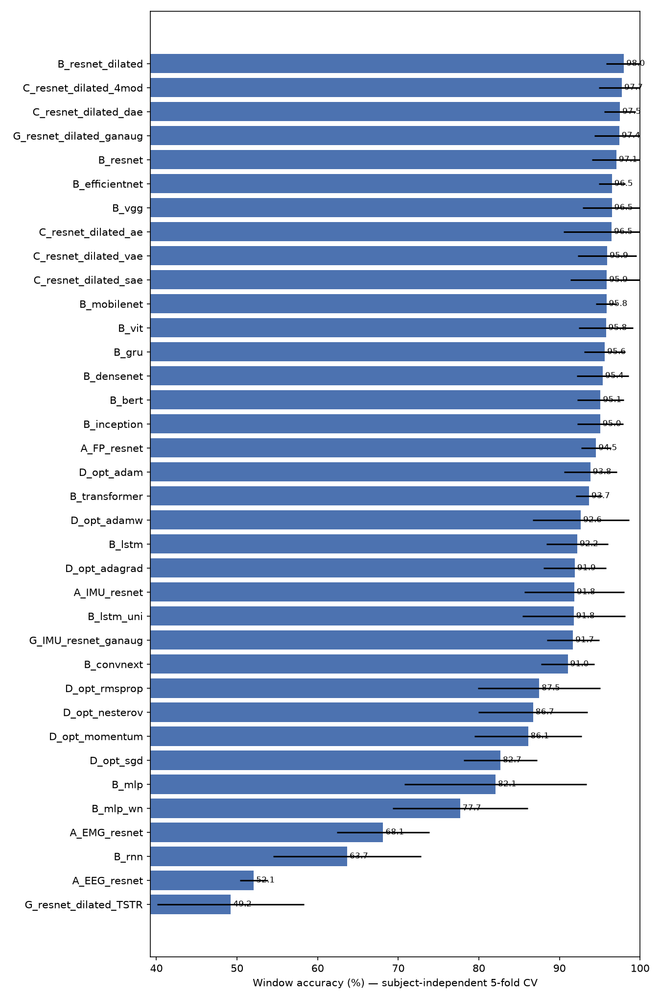

# Walking-Speed Recognition from Multimodal Gait Signals (ADL Lab Project)

Deep-learning classification of treadmill walking speed (**0.5 / 0.75 / 1.0 m/s**) from the
PhysioNet *Multimodal Gait Dataset* (59 healthy young adults; EEG, EMG, IMU kinematics and
force plates). **Only architectures from the course syllabus are used**, and every model is
evaluated **subject-independently**: the people in each test fold are never seen in training.

## Headline result

| Model | Window accuracy | Trial accuracy |
|---|---|---|
| **Soft-voting ensemble** of 5 syllabus models (IMU+FP+EMG) | **98.68 %** (macro-F1 98.68 %) | **99.37 %** (158/159 trials) |
| Best single model: **ResNet with dilated convolutions** (IMU+FP+EMG) | 98.01 ± 2.21 % | 98.74 % |

Ensemble members (top 5 by CV accuracy): dilated ResNet, dilated ResNet + denoising-AE
pre-training, dilated ResNet + GAN augmentation, ResNet, EfficientNet.
*Window* = one 4-s segment; *trial* = one 60-s recording (softmax averaged over its windows).



## Data and preprocessing (`src/prepare_data.py`)

| Modality | Raw | After preprocessing | Trials |
|---|---|---|---|
| IMU (Xsens, 17 sensors) | 60 Hz | joint angles + segment angular velocity + sensor free acceleration, 204 ch | 167 |
| Force plates (split-belt) | 1000 Hz | Fx,Fy,Fz,Mx,My,Mz (÷ body weight) + COP per belt, FIR-decimated to 100 Hz, 16 ch | 173 |
| EMG (Delsys, 12 muscles) | ~16 Hz MAV | log-MAV, resampled to 16 Hz, trailing zero padding removed | 169 |
| EEG (DSI-24, dry) | 300 Hz | 18 scalp ch, 1–40 Hz band-pass, common-average reference, 100 Hz, clipped ±150 µV | 176 |

Dataset issues found and handled:
- **S32, EEG at 1.0 m/s:** the channel header is corrupted, so the recording is excluded.
- **S47, IMU:** the joint-angle CSVs are empty at all 3 speeds, so S47 has no IMU data.
- **S2, force plates:** the CSVs have no header row, so they are parsed using the standard 22-column layout.

All downloads were verified against PhysioNet's `SHA256SUMS.txt`.

## Evaluation protocol (`src/train.py`)
- **5-fold cross-validation grouped by subject** (seed 42). Inside each training fold, 15% of
  subjects are held out for early stopping.
- Normalisation statistics, autoencoder pre-training and GAN training all use **only that fold's
  training subjects**.
- 4-s windows with a 1-s hop. Training uses random temporal crops, per-channel scaling and
  Gaussian noise.
- Fusion: one encoder per modality, followed by a Transformer encoder over the modality tokens
  (with modality dropout), then an MLP head.
- Training setup: AdamW with OneCycle LR, label smoothing 0.1, gradient clipping 1.0, and
  bf16 mixed precision on an RTX 4060 Laptop GPU.

## Syllabus coverage

| Unit | Concept | Where |
|---|---|---|
| ML preliminaries | supervised learning, under/over-fitting, bias–variance | subject-grouped CV; MLP (4.7 M params) overfits: ±11 % fold std, 82 % |
| | deep feed-forward nets, backprop, GD/SGD, activations, init | `MLP`; ReLU/GELU/SiLU/Tanh; He (Kaiming) init |
| | vanishing / exploding gradients | residual & dense connections, gated RNNs vs vanilla RNN, gradient clipping |
| Optimisation | Mini-batch SGD, Momentum, Nesterov, Adagrad, RMSProp, Adam | optimiser study (D) |
| | Batch Norm, Layer Norm, Weight Norm | BN in CNNs/MLP; LN in Transformers, ConvNeXt, RNN; `mlp_wn` uses Weight Normalization |
| | L1/L2, Dropout, Early stopping | AdamW weight decay (L2), `--l1`, Dropout, modality dropout, early stopping |
| CNNs | convolution, depthwise-separable & dilated conv, pooling, stride | MobileNet/EfficientNet/ConvNeXt (depthwise-separable), dilated ResNet, max/avg/global pooling, strided convs |
| | VGG, Inception, ResNet, DenseNet, MobileNet, EfficientNet, ConvNeXt | all seven implemented as 1-D networks (`src/models.py`) |
| Sequence models | RNN, bidirectional RNN, many-to-one | vanilla RNN, BiGRU, BiLSTM vs unidirectional LSTM; many-to-one classification |
| Attention models | GRU, LSTM, attention, Transformer, BERT, ViT | additive attention pooling; Transformer encoder; ViT (patch tokens + [CLS]); BERT (masked-token pre-training) |
| Generative models | Autoencoder (basic / denoising / sparse), VAE | encoder pre-training (C) |
| | GAN objective & training challenges | conditional GAN augmentation + train-on-synthetic test (G) |

Not used: Word2Vec and GloVe, because they are text embeddings and the inputs here are sensor
signals. RBMs and DBNs are also not used, because they are designed for binary/static inputs.

## Results (5-fold subject-independent CV, window accuracy ± fold std)

### A. Single modality (ResNet)
| Modality | Window acc | Trial acc |
|---|---|---|
| Force plates | 94.54 ± 1.86 | 94.22 |
| IMU | 91.84 ± 6.18 | 92.81 |
| EMG | 68.12 ± 5.73 | 70.41 |
| EEG | 52.08 ± 1.73 | 51.70 |

Chance level is 33.3 %.

### B. Architecture comparison (IMU + FP + EMG)
| Family | Model | Params | Window acc | Trial acc |
|---|---|---|---|---|
| CNN | **ResNet, dilated** | 2.02 M | **98.01 ± 2.21** | **98.74** |
| CNN | ResNet | 2.07 M | 97.07 ± 3.04 | 97.48 |
| CNN | EfficientNet | 1.55 M | 96.51 ± 1.65 | 98.74 |
| CNN | VGG | 2.89 M | 96.50 ± 3.60 | 97.48 |
| CNN | MobileNet | 1.33 M | 95.82 ± 1.32 | 97.48 |
| CNN | DenseNet | 1.85 M | 95.37 ± 3.23 | 96.23 |
| CNN | Inception | 0.91 M | 95.05 ± 2.86 | 95.60 |
| CNN | ConvNeXt | 3.54 M | 91.03 ± 3.29 | 91.19 |
| Attention | ViT | 3.05 M | 95.77 ± 3.37 | 97.48 |
| Attention | BERT (masked-token pre-trained) | 3.28 M | 95.09 ± 2.91 | 94.97 |
| Attention | Transformer encoder | 2.82 M | 93.66 ± 1.61 | 96.23 |
| Recurrent | BiGRU + attention | 1.46 M | 95.63 ± 2.56 | 96.23 |
| Recurrent | BiLSTM + attention | 1.74 M | 92.21 ± 3.85 | 93.71 |
| Recurrent | LSTM (unidirectional) | 0.95 M | 91.77 ± 6.37 | 93.08 |
| Recurrent | vanilla RNN (bidirectional) | 0.90 M | 63.66 ± 9.19 | 64.78 |
| Feed-forward | MLP + BatchNorm | 4.71 M | 82.07 ± 11.28 | 85.53 |
| Feed-forward | MLP + WeightNorm | 4.71 M | 77.67 ± 8.38 | 78.62 |

Observations:
- **Fusion helps.** The best fused model beats the best single modality (force plates, 94.5 %)
  by 3.5 points.
- **Dilated convolutions help.** Dilated ResNet scores 98.0 % against 97.1 % for plain ResNet:
  it covers a longer stretch of the gait cycle (a wider receptive field) without striding.
- **Vanilla RNN fails** at 63.7 %, while GRU and LSTM reach 92–96 %. This is the vanishing
  gradient problem that gating was designed to solve. Bidirectionality adds a little: BiLSTM
  92.2 % vs LSTM 91.8 %.
- **Inductive bias matters on small data.** CNNs beat the Transformer family (about 16 k
  training windows), and the MLP, which has no temporal structure, overfits badly.

### C. Generative pre-training and EEG (dilated ResNet, IMU+FP+EMG)
| Setting | Window acc | Trial acc |
|---|---|---|
| no pre-training | **98.01 ± 2.21** | 98.74 |
| + denoising autoencoder | 97.51 ± 1.95 | 98.74 |
| + basic autoencoder | 96.47 ± 5.95 | 97.48 |
| + VAE | 95.92 ± 3.63 | 96.86 |
| + sparse autoencoder | 95.87 ± 4.50 | 96.23 |
| all 4 modalities (adds EEG) | 97.75 ± 2.86 | 98.10 |

Unsupervised pre-training does not help this already strong supervised model. The denoising
autoencoder is the best of the four variants. Adding EEG slightly hurts, because the
dry-electrode EEG recorded during walking is noisy.

### G. Conditional GAN
| Setting | Window acc | Baseline |
|---|---|---|
| GAN augmentation, dilated ResNet (IMU+FP+EMG) | 97.42 ± 3.10 | 98.01 |
| GAN augmentation, ResNet (IMU) | 91.68 ± 3.25 | 91.84 |
| Train on synthetic only, test on real (TSTR) | 49.22 ± 9.12 | chance 33.3 |

- **Objective:** non-saturating minimax loss.
- **Stabilisation:** spectral normalisation, a projection discriminator, one-sided label
  smoothing, two-time-scale learning rates, and Adam with β₁ = 0.5.
- **Training behaviour:** discriminator and generator losses stay balanced (D ≈ 0.7, G
  falling from about 4.9 to 2.5), so training does not collapse.
- **Sample quality:** TSTR is 49 %, well above chance but far below the 98 % from real data.
  The generator captures the speed classes only coarsely, so augmentation adds no accuracy.
  That limited fidelity is a classic GAN challenge on small multichannel datasets.

### D. Optimiser study (ResNet, IMU, 25 epochs, OneCycle LR)
| Optimiser | Window acc | Trial acc |
|---|---|---|
| Adam | **93.83 ± 3.27** | 95.21 |
| AdamW | 92.65 ± 5.98 | 92.81 |
| Adagrad | 91.90 ± 3.91 | 93.41 |
| RMSProp | 87.48 ± 7.61 | 88.62 |
| Nesterov momentum | 86.73 ± 6.78 | 86.83 |
| Momentum | 86.11 ± 6.66 | 86.83 |
| SGD (plain mini-batch) | 82.67 ± 4.53 | 82.04 |

Adaptive methods (Adam, AdamW, Adagrad) do best, momentum methods come next, and plain SGD
is last. Nesterov is marginally better than classical momentum.

## Caveats
- The ensemble's members were chosen by their CV scores, so the 98.7 % / 99.4 % figure is
  slightly optimistic. The single-model numbers do not have this problem.
- Speeds were always recorded in the same order (0.5 → 0.75 → 1.0), so fatigue or
  time-on-task is confounded with speed in this dataset.
- Force-plate data is only approximately synchronised with the other modalities. This
  matters little here because labels are per trial.
- Earlier results from a custom hybrid CNN (not a syllabus architecture) are kept in
  `results_v1_custom_models/` for reference only.

## Reproduce

```powershell
python -m venv .venv
.venv\Scripts\python -m pip install torch --index-url https://download.pytorch.org/whl/cu128
.venv\Scripts\python -m pip install numpy pandas scipy scikit-learn matplotlib
bash download.sh csv; bash download.sh imu       # ~6.5 GB, checksum-verified
tar xzf data/IMU_Data/IMU.tar.gz -C data/IMU_Data
.venv\Scripts\python src\prepare_data.py
bash run_experiments.sh stage1                    # A, B, D   (~2.5 h on an RTX 4060 Laptop)
bash run_experiments.sh stage2 resnet_dilated     # C, G      (~1.5 h)
.venv\Scripts\python src\report.py $(.venv\Scripts\python src\pick.py ensemble)
```

Single run: `.venv\Scripts\python src\train.py --mods IMU FP EMG --encoder resnet_dilated`
(other options: `--encoder vgg|inception|resnet|densenet|mobilenet|efficientnet|convnext|rnn|gru|lstm|lstm_uni|transformer|vit|bert|mlp|mlp_wn`,
`--pretrain ae|dae|sae|vae`, `--gan_aug 0.5`, `--gan_only`, `--opt sgd|momentum|nesterov|adagrad|rmsprop|adam|adamw`).

## Files
- `src/prepare_data.py`: raw CSVs → per-trial arrays
- `src/models.py`: every syllabus architecture, the fusion network, the AE/VAE wrapper and the conditional GAN
- `src/train.py`: subject-grouped CV training, pre-training and GAN augmentation
- `src/report.py`, `src/pick.py`: results table, ensemble and figures
- `results/summary.md`, `results/results.jsonl`, `results/*.png`

## Citation
Katmah R., AlShehhi A., Kosaji D., Al-Rahmani N., Abdullah M., Hulleck A. A. V., Khalaf K. (2026).
*A multimodal gait dataset of brain activity, muscle activity, kinematics and ground forces in
young adults* (v1.0.0). PhysioNet. https://doi.org/10.13026/r0ea-7161 — CC BY 4.0.
